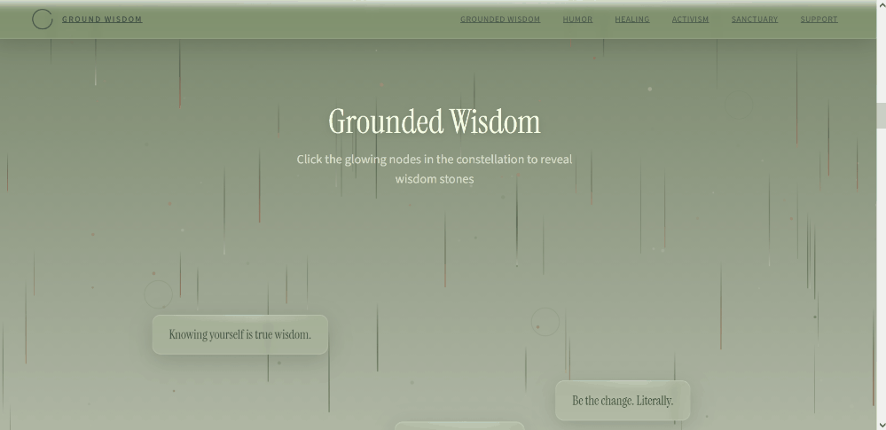

# Ground Wisdom

An experimental, interactive landing page exploring grounded wisdom, humor, healing, and activism through a calm, nature-inspired visual design.

[**View the live site**](https://kimis-prototype.geekgelasia.dev/)



## About

Ground Wisdom is a visual web prototype built around the idea of making reflective content feel engaging and approachable. It combines editorial typography, layered visuals, and interactive details in a single-page experience.

This project is a design and front-end experiment, not a finished product. It is not under active development, and some sections or interactions may be incomplete.

## Highlights

- A multi-section, single-page experience, from an animated introduction through wisdom, humor, healing, activism, and support.
- Interactive visual experiments, including animated graphics, card interactions, and a breathing exercise.
- A responsive interface built with React and TypeScript.

## Built with

- React 19 and TypeScript
- Vite
- Tailwind CSS
- Three.js and React Three Fiber
- GSAP

## Run locally

Requires Node.js 20 or later.

```bash
npm install
npm run dev
```

To check the production build and lint the project:

```bash
npm run build
npm run lint
```

## Project status

This is a portfolio prototype. It is shared to showcase the design direction and selected front-end experiments; it is not a promise of ongoing maintenance or support.

## Credits and licensing

The project uses third-party libraries listed in `package.json`. Please check the source and licensing of visual assets before reusing them.

No license is currently provided for this repository. Unless a license is added, don’t assume the code or assets are available for reuse.
